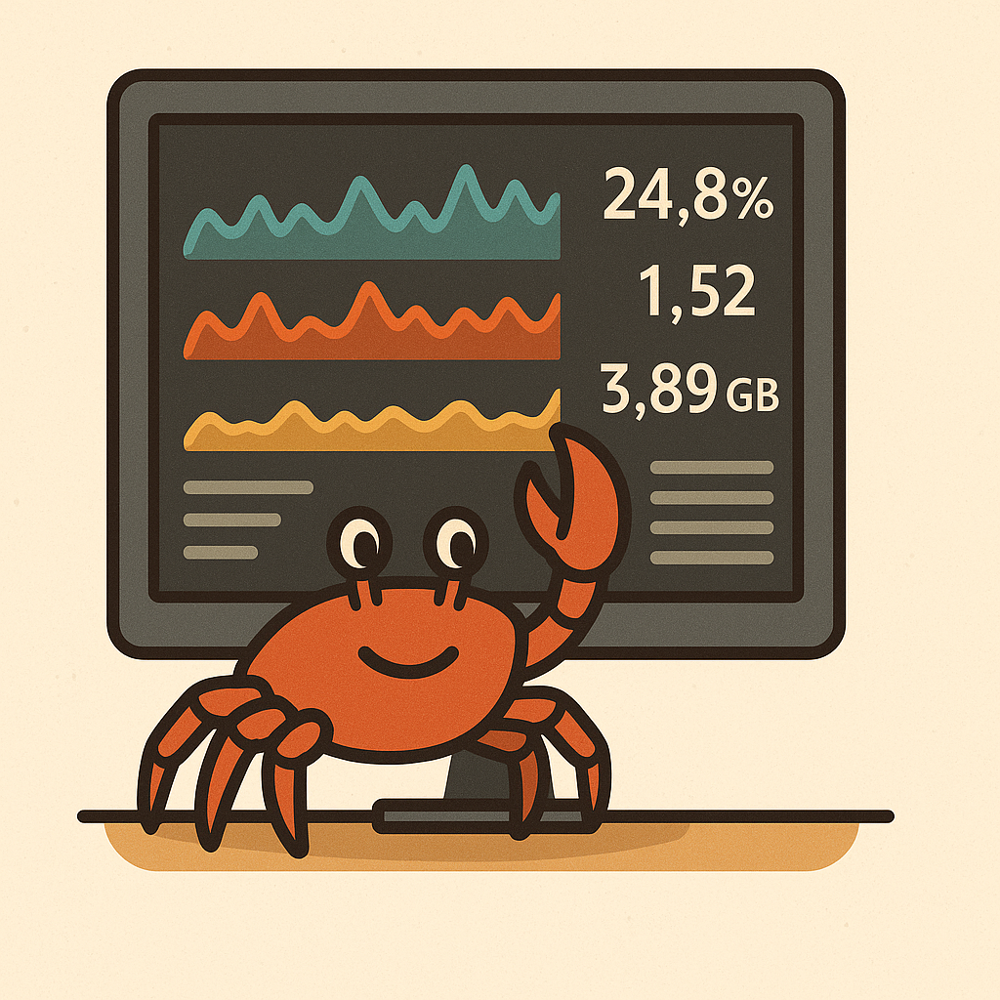

# crabmon 🦀

A fast, keyboard-driven terminal system monitor written in Rust, built on
[`ratatui`](https://github.com/ratatui-org/ratatui) and
[`sysinfo`](https://github.com/GuillaumeGomez/sysinfo).

crabmon shows per-core CPU history, memory and swap, a sortable/filterable
process table with a tree view and per-process disk IO, network throughput,
per-mount disk usage and IO, temperature sensors, GPU load and cgroup limits —
and it can print all of it as JSON or CSV for scripts.



The same thing as text, captured from a one-core VPS with
`make snapshot` — which drives a real pty through tmux, so this is the
interface as drawn rather than a description of it:

<!-- snapshot:begin -->
```text
┌ crabmon ─────────────────────────────────────────────────────────────────────────────────────────┐
│vps3639009.trouble-free.net  Linux (Ubuntu 26.04)      1 cpu  load 0.92 1.16 1.07  up 31d 04:44:57│
└──────────────────────────────────────────────────────────────────────────────────────────────────┘
┌ CPU   5.0%  2.10 GHz  ───────────────────────────────────┐┌ Network [phys]  ↓ 1.0 KiB/s  ↑ 67 B/s┐
│100│                                                      ││Iface     ↓ rate    ↑ rate   total    │
│   │                                                      ││eth0      1.0 KiB/s 67 B/s   6.4 GiB  │
│   │                                                      ││                                      │
│   │                                                      ││                                      │
│0  │⣀⣀⡠⠤⠤⠤⠤⠒⠒⠒⠒⠒⠒⠒⠤⠤⠤⠤⠤⠤⠤⠤⠤⠤⠤⠤⠤⠤⠤⠤⠤⠤⠤⠤⠤⠤⠤⠤⠤⠤⢄⣀⣀⣀⣀⣀⣀⣀⣀⡠⠤⠤⠤⠤││                                      │
│                                                          │└──────────────────────────────────────┘
└──────────────────────────────────────────────────────────┘┌ Pressure ────────────────────────────┐
┌ Memory ──────────────────────────────────────────────────┐│     some    full    10s              │
│ 43.2%  710.0 MiB / 1.6 GiB  (932.9 MiB avail, 976.1 MiB c││cpu    2.4%    0.0%  ░░░░░░░░░░░░░░░░ │
└──────────────────────────────────────────────────────────┘│mem    0.1%    0.0%  ░░░░░░░░░░░░░░░░ │
┌ Swap ────────────────────────────────────────────────────┐│io     2.4%    2.1%  ░░░░░░░░░░░░░░░░ │
│██████████████ 75.9%  776.7 MiB / 1024.0 MiB              │└──────────────────────────────────────┘
└──────────────────────────────────────────────────────────┘┌ Sensors (°C) ────────────────────────┐
┌─ Processes ──────────────────────────────────────────────┐│no temperature sensors                │
│  PID     USER      S CPU%↓  MEM     DISK      COMMAND    ││                                      │
│  947116  root      S   2.5    7.6M          - crabmon    ││                                      │
│  895846  -         S   1.2    139M          - uvicorn    ││                                      │
│  1       root      S   0.0   10.6M          - systemd    ││                                      │
│  2       root      S   0.0      0B          - kthreadd   │└──────────────────────────────────────┘
│  3       root      S   0.0      0B          - pool_workq…│┌ Disks ───────────────────────────────┐
│  4       root      I   0.0      0B          - kworker/R-…││████████/  23.1 GiB / 37.3 GiB        │
│  5       root      I   0.0      0B          - kworker/R-…││█████/boot  245.2 MiB / 973.4 MiB     │
│  6       root      I   0.0      0B          - kworker/R-…││██/var/lib/do…  23.1 GiB / 37.3 GiB   │
│  7       root      I   0.0      0B          - kworker/R-…││██/var/lib/do…  23.1 GiB / 37.3 GiB   │
└──────────────────────────────────────────────────────────┘└──────────────────────────────────────┘
 127 shown of 265 tasks · sort CPU%↓ · 800 ms · [?] help
```
<!-- snapshot:end -->

## Features

- **CPU** — average-usage history chart plus a per-core strip, and a dedicated
  full-screen layout with one bar per core and live clock speeds.
- **Memory & swap** — usage gauges colour-coded green → yellow → red, with the
  reclaimable buffers/cache share spelled out so a scary "used" figure has its
  context. Per process, `[procs] pss` adds **PSS** — the process's private
  pages plus its share of every page it shares — because RSS counts a page
  shared by eight Chromium processes eight times, so adding up a tree's RSS
  can exceed the memory the machine has. On this machine the two differ by
  almost half. A **GROWTH** column sorts by what each process has gained over
  the window the trend charts cover, so a leak is found by pressing a key
  rather than by writing a rule and waiting.
- **Processes** — PID, user, state, CPU%, a CPU sparkline, RSS, virtual size,
  thread count, nice, disk IO, run time, listening ports and command, sortable on
  every column (keyboard or by clicking the header), with a tree view, a query
  language, and a detail pane on `Enter` showing the process's open sockets and
  the files it is holding open — "which log is filling the disk" without
  leaving crabmon for `lsof` and losing the process you were looking at. The
  same pane carries its OOM score and the `oom_score_adj` anybody has put on
  the scale, its IO priority, the cgroup it is really in, and the environment
  it was started with — with the values of variables that look like
  credentials withheld, because a monitor is a thing people screenshot into
  tickets and project onto a wall during an incident.
  Threads are hidden by default (`H` shows them), so the list reflects processes
  rather than every kernel task, and `o` folds a subtree away — a browser with
  two hundred children otherwise buries everything else, which is the opposite
  of what a tree view is for. Tag several with `Space` to signal, renice or
  pin them at once, and `f` keeps one process at the top of the table however the
  rest churns. The column set can be fixed in the config instead of fitting the
  terminal width.
- **Process control** — signal menu, renice, CPU affinity and IO priority.
  CPU priority does nothing for a process that is saturating a disk, which is
  the one anybody actually wants to turn down, so `I` sets the IO scheduling
  class and level the way `ionice` spells them — `be 4`, `idle`, `rt 0`.
  Signals take a two-step confirmation, and all four refuse to act if the PID
  was recycled while the prompt was open — or if the processes on screen are
  not this machine's at all, which is what `--remote` and `--replay` put
  there.
- **Network** — per-interface rates and totals with an RX/TX history chart.
  Loopback, bridges, veth pairs and VPN tunnels are excluded from the aggregate
  by default so the same bytes are not counted twice.
- **Per-container accounting** — each container's and unit's own cgroup is
  read directly (`memory.current`, `memory.max`, `cpu.stat`, `cpu.max`)
  rather than summed from its processes. A sum misses kernel memory, page
  cache and anything charged to the group rather than a task, and it cannot
  see the *limit* at all — so the grouped view carries a LIMIT column, and
  `crabmon_cgroup_memory_bytes` and friends are exported.
- **Per-container network** — the kernel accounts bytes to a network
  namespace rather than to a PID, and every process in a container shares one,
  so the grouped view carries each container's throughput and `--serve`
  exports it. Per-*process* bytes would need eBPF or packet capture, and so
  privileges crabmon does not ask for; this is the honest figure underneath
  the question people are usually asking.
- **Disks** — one usage gauge per mount with live read/write throughput, and
  a **time to full** for any filesystem that is filling, because 95% of a
  4 TB array is days of warning and 95% of a 20 GB root is twenty minutes,
  including LVM and LUKS volumes, and a warning when a filesystem is running
  out of inodes rather than bytes. Busy devices are labelled with their
  utilisation and mean request latency: an NVMe serving small random reads is
  pinned at a few MB/s, and a throughput figure draws that as very nearly idle.
- **Kernel events** — OOM kills, segfaults, kernel oopses and block-IO
  errors, read from `/dev/kmsg`. The dashboard shows memory *now*, and the
  process the OOM killer chose is by definition no longer in the table, so
  "what got killed, and when" was the one question nothing on screen could
  answer. Opening the device replays the ring, so a kill from twenty minutes
  ago is visible the moment crabmon starts. Where `kernel.dmesg_restrict=1`
  makes the device root-only the panel says so rather than showing an
  empty list, which would read as "nothing has gone wrong".
- **Sensors** — temperatures grouped by driver, so a 22-core `coretemp` flood
  does not push the NVMe and chassis sensors off the panel.
- **GPU** — utilisation, VRAM and temperature from `/sys/class/drm`, with
  optional `nvidia-smi` support.
- **cgroups** — when the process is confined, an extra panel with the cgroup's
  own memory usage against its limit and its CPU quota, neither of which the
  host totals reflect.
- **Pressure** — PSI stall time (`some` and `full`) for CPU, memory and IO: the
  number that explains a machine that feels frozen while the CPU graph looks
  idle.
- **Power** — battery charge, charge/discharge watts, time remaining, cell
  health, mains state, and CPU package draw from RAPL where it is readable.
- **Grouping** — aggregate the process table by systemd unit, container or user,
  totalling CPU, memory and disk IO per group, and `Enter` to open a group into
  the processes behind it.
- **Alerts** — configurable thresholds with a hold time, command hooks for both
  firing and recovering, and a log of every transition. Rules can watch CPU,
  memory, swap, load, disk capacity or saturation, temperature, GPU, pressure
  stall, network throughput, file descriptors — or the number of processes
  matching a filter query, which with `below` is how you get paged when
  something *stops*, and `kind = "trend"` on growth rather than level — the
  process leaking 200 MB every ten minutes, or whose disk rate or CPU has been
  climbing since Tuesday, which no threshold catches until it is too late to
  act on. `--serve --alerts` and `--stream --alerts` run the same
  rules with no terminal at all, exporting each one firing or not — which is
  what puts pressure stall, device saturation and descriptor exhaustion within
  reach of a pager.
- **File descriptors** — an optional FD column with each process's count
  against its own `RLIMIT_NOFILE`, plus `fd>` and `fd%>` filters and an alert
  kind. Descriptor exhaustion is to a process what inode exhaustion is to a
  filesystem: the resource that runs out while every other gauge looks fine.
- **Export** — write a snapshot as JSON, CSV or a plain aligned table from the
  TUI, or run `crabmon --once` headless. `--format text` is the `top -b -n1`
  shape, laid out by the same column planner the interface uses, for when the
  question is "what is this box doing" over SSH and `jq` is not the answer.
- **Record & replay** — `--record` writes every sample to a JSONL file (trimmed
  to keep it a sane size) and `--replay` drives the whole UI from one, so "send
  me a recording of the slowdown" is a workable bug report. `--record-rotate`
  keeps a bounded window of it on disk at all times, and both work headlessly
  under `--stream`, `--serve` and `--watch` — so the always-on recorder is a
  systemd unit rather than something that needs a terminal in front of it.
- **Flight recorder** — `[record] flight` keeps the last N frames in memory and
  writes them out, with the aftermath, whenever an alert fires. The recording
  of an incident then exists because the incident happened, rather than because
  someone thought to start recording first.
- **Diff** — `--diff before.json after.json` reduces two snapshots to what
  actually changed: what started, what exited, what grew.
- **Watch** — `--watch 'state:D'` blocks until processes match and exits
  non-zero, so a shell script can wait on a condition; `--watch-rule 'cpu>=90'`
  waits on any measurement an alert can, including `proc:nginx<1` for "it has
  stopped". Both are alert rules underneath, so a condition means the same
  thing in a script, in the config file and in the exporter.
- **Prometheus** — `--serve :9100` runs headless and exposes CPU, memory, swap,
  load, disks, interfaces, sensors, pressure, power and GPU, plus the busiest
  processes (capped, and configurable), including per-device utilisation and
  request latency and, where `[procs] fds` is on, per-process descriptor counts
  against their limits. A scrape carries every command line on the machine, so
  `[serve] token` (or `CRABMON_SERVE_TOKEN`) can require an
  `Authorization: Bearer` header before crabmon will answer with any of it;
  `/healthz` stays open, because a liveness probe that needs a credential is a
  liveness probe that gets switched off. `--serve unix:/run/crabmon.sock`
  skips the network altogether and lets filesystem permissions do the work.
- **Remote** — `--remote host` monitors another machine over SSH, with no
  daemon and no open port, over one long-lived session rather than a process
  per sample. `--remote web-1,web-2,db-1` opens a fleet table instead: one row
  per host, sampled concurrently, so the machine in trouble is visible before
  you have picked one and an unreachable host costs the others nothing.
- **Never blocks** — sampling runs on its own thread, so a slow `nvidia-smi`, a
  wedged NFS mount or a stalled SSH link leaves the interface responsive instead
  of freezing it.
- **Live config reload** — `Ctrl-R` re-reads the config file and applies it
  without restarting: thresholds, colours, panels, columns and `[[alert]]`
  rules. The filter, tags, pins, selection, layout and sort are session state
  and survive. Editing a config mid-incident is exactly when restarting costs
  the most.
- **Action log** — every signal, renice and affinity change is recorded to a
  local file, viewable in the TUI with `L`.
- **Self-check** — `crabmon --doctor` says what this machine will and will not
  let crabmon see, and exits non-zero when the config asks for something that
  cannot work here. crabmon never reports zero for a thing it could not read,
  which is right and leaves "is that nothing, or something I am not allowed to
  see?" as a question only this answers.
- **Themes and layouts** — five colour themes, five layouts, and a config file
  that covers every panel, threshold and colour.

## Install

### From source

```sh
make bin
./bin/crabmon
```

Requires Rust 1.95 or newer (edition 2024; the floor is `sysinfo`'s, not the
edition's). `make` on its own lists
every target. To put the binary, the man page and the shell completions on the
system:

```sh
sudo make install                    # under /usr/local
make install PREFIX="$HOME/.local"   # ...or somewhere that needs no root
```

`make uninstall` takes the same variables and removes exactly those files.

### Debian package

```sh
make deb
```

The result is `target/debian/crabmon_<version>_<arch>.deb`, which installs the
binary, the man page and shell completions:

```sh
sudo dpkg -i target/debian/crabmon_*.deb
```

## Usage

Run `crabmon`. It draws into the alternate screen and restores your terminal on
exit, including after a panic.

```
crabmon                              # dashboard
crabmon -s mem -l processes          # full-width process table, sorted by memory
crabmon -f 'user:root cpu>5' -t      # filtered, tree view
crabmon --once --top 20              # top 20 processes as JSON, then exit
crabmon --once --format csv          # ...or as CSV
crabmon --record run.jsonl           # record this session
crabmon --replay run.jsonl           # ...and replay it later
crabmon --remote build-server        # another machine, over SSH
crabmon --serve :9100                # headless Prometheus exporter
crabmon -g service                   # aggregate by systemd unit
crabmon --diff before.json after.json # what changed between two snapshots
crabmon --diff run.jsonl             # ...or between the ends of one recording
crabmon --watch 'state:D' --watch-for 30   # block until something is stuck
crabmon --stream > frames.jsonl      # one JSON snapshot per line, forever
```

Signals, renice and affinity apply to every tagged process when there are any,
so `/`-filter, `Space` a few rows, then `t` is the fast path for cleaning up a
run of stuck workers.

### Options

| Option | Meaning |
| --- | --- |
| `-r`, `--refresh <MS>` | Refresh interval, 200–10000 ms |
| `-s`, `--sort <KEY>` | `pid`, `name`, `cpu`, `mem`, `virt`, `disk`, `time`, `user`, `state`, `threads`, `nice`, `fds`, `pss`, `growth` |
| `-a`, `--ascending` | Sort ascending |
| `-d`, `--descending` | Sort descending (the default) |
| `-f`, `--filter <QUERY>` | Initial process filter |
| `-t`, `--tree` | Start in process-tree view |
| `-l`, `--layout <NAME>` | `dashboard`, `processes`, `cpu`, `io`, `fleet` |
| `--theme <NAME>` | `default`, `mono`, `nord`, `solarized`, `gruvbox` |
| `--no-color` | Disable colour (same as `--theme mono`) |
| `--no-mouse` | Do not capture mouse events |
| `-1`, `--once` | Print one snapshot and exit (this host only) |
| `--format <FMT>` | `json` (default), `csv` or `text` for `--once` and `--watch`; `--diff` renders `json` or text |
| `-n`, `--top <N>` | Limit `--once` and `P` snapshot output to the top N processes |
| `-c`, `--config <PATH>` | Use an alternate config file |
| `-g`, `--group <BY>` | Group processes: `none`, `service`, `container`, `user` |
| `--columns <LIST>` | Process-table columns, e.g. `pid,user,cpu,mem,name` |
| `--record <PATH>` | Record every sample to a JSONL file, replacing it if it exists; works headless too |
| `--record-rotate <DIR>` | Keep a rotating recording in DIR: `[record] rotate_keep` segments of `rotate_frames` frames, oldest deleted; works headless too |
| `--replay <PATH>` | Replay a recording instead of sampling this host |
| `--remote <TARGET>` | Monitor TARGET over SSH; comma-separated for a fleet |
| `--remote-command <C>` | Command to run on the remote host |
| `--serve <ADDR>` | Serve Prometheus metrics on ADDR (`:9100` or `unix:/path.sock`), headless; with `--remote`, a whole fleet |
| `--stream` | Print one JSON snapshot per line forever (this host only) |
| `--alerts` | With `--serve`/`--stream`: evaluate alert rules headlessly |
| `--diff <A> [B]` | Compare two snapshots, or one recording end to end |
| `--doctor` | Report what this host lets crabmon measure, and exit |
| `--watch <QUERY>` | Block until processes match QUERY, then exit 1 |
| `--watch-rule <EXPR>` | ...or until a measurement does: `cpu>=90`, `proc:nginx<1` |
| `--watch-for <SECS>` | ...only once the match has held this long |
| `--watch-timeout <SECS>` | ...giving up after this long; 0 waits forever |
| `-h`, `--help` / `-V`, `--version` | Help / version |

### Key bindings

| Key | Action |
| --- | --- |
| `q`, `Ctrl-C` | Quit |
| `↑`/`k`, `↓`/`j` | Move selection |
| `PgUp`, `PgDn` | Move a page |
| `Home`, `End` | First / last process |
| `Enter` | Process detail pane, or open the selected group |
| `/` | Filter processes |
| `Esc` | Clear the filter |
| `c` `m` `p` `n` `d` | Sort by CPU / memory / PID / name / disk IO |
| `<`, `>` (or `,` `.`) | Previous / next sort column |
| `s` | Reverse the sort order |
| click a header | Sort by that column |
| `T` | Toggle the process tree |
| `o`, `O` | Fold / unfold a subtree (tree view) |
| `H` | Show or hide individual threads |
| `G` | Group by service, container or user |
| `W` | Show the fleet table (several `--remote` hosts) |
| `Space` | Tag a process for a bulk action |
| `U` | Untag everything |
| `f` | Pin a process to the top of the table |
| `F` | Unpin everything |
| `z` | Pause and resume sampling |
| `[`, `]` | Step a recording back or forward |
| `{`, `}` | Step a recording ten frames |
| `1`–`9` | Apply a saved filter |
| `0` | Clear the filter |
| `y` | Copy the command line to the clipboard |
| `L` | Action log |
| `Tab`, `Shift-Tab` | Next / previous layout |
| `v` | Count virtual interfaces in the network total |
| `g` | Group or expand sensors |
| `+`, `-` (or `=` `_`) | Refresh faster / slower |
| `t` | Signal menu *(Unix)* |
| `r` | Renice *(Unix)* |
| `A` | CPU affinity *(Linux)* |
| `I` | IO priority (ionice) *(Linux)* |
| `P` | Export a snapshot |
| `!` | Active alerts and the rules behind them |
| `Ctrl-R` | Reload the config file, keeping the session |
| `?`, `F1` | Show all key bindings |
| mouse wheel | Scroll the process list |
| mouse click | Select a process |
| `j`/`k`, PgUp/PgDn in a popup | Scroll it |

Pressing the key of the column you are already sorting by reverses the order.

**Filter mode** (`/`) filters as you type. `Enter` returns to navigation keeping
the filter, `Esc` clears it. A malformed query is shown in red rather than
silently matching nothing.

**IO priority** (`I`) takes what `ionice(1)` takes: a class — `none`, `rt`,
`be` or `idle` — and, for `rt` and `be`, a level from 0 (highest) to 7. `be`
on its own means the middle of its range. A level on `idle` or `none` is
refused rather than quietly ignored. `rt` needs `CAP_SYS_ADMIN`.

**Signal menu** (`t`) offers SIGTERM, SIGKILL, SIGINT, SIGHUP, SIGQUIT, SIGSTOP,
SIGCONT, SIGUSR1 and SIGUSR2. A confirmation prompt asks `y`/`n` before anything
is sent, and the signal is refused if the PID was recycled while the prompt was
open.

**Folding** (`o`) hides the subtree under the cursor and marks the row with
how many rows it is standing in for — `+40 chrome`. A browser or a build with
two hundred children otherwise buries everything else, which is the opposite
of what the tree view is for. `O` unfolds everything. Folds are kept by PID,
so they survive a refresh and vanish with the process.

**Reload** (`Ctrl-R`) re-reads the config file and applies it without
restarting: thresholds, colours, panels, columns and — the reason it exists —
`[[alert]]` rules. The filter you typed, what is tagged, pinned and selected,
the layout and the sort are session state and are kept. A file that does not
parse changes nothing and says so in the status line. Editing a config
mid-incident is exactly when restarting costs the most.

**Saved filters** (`1`–`9`) come from `[[filter_preset]]`. A fresh config ships
five: `busy` (`cpu>5`), `hungry` (`mem>500M`), `mine` (`user:$USER`), `io`
(`io>100K`) and `stuck` (`state:D`). `0` clears the filter again.

### Filter language

Terms are separated by whitespace and combined with AND; `!` negates a term. A
standalone `|` is OR and binds looser than the implicit AND, so `a b | c` means
`(a AND b) OR c`.

```
firefox            name contains "firefox"
!kworker           name does not contain "kworker"
nginx | apache     either one
user:vlad          user name contains "vlad"
pid:1234           exact PID          ppid:1  exact parent PID
state:R            process state letter
service:sshd       systemd unit; service:- means "no unit"
container:abc123   container id; container:- means "not in one"
cmd:--headless     substring of the full command line
re:^chrom(e|ium)$  regular expression over the process name
cpu>5              CPU comparison, with > >= < <= =
mem>100M           resident memory, with K/M/G/T suffixes
virt>2G            virtual size, same suffixes
io>1M              disk IO rate
thr>50             thread count
nice<0             scheduling priority
time>2h            run time, in s/m/h/d; a bare number is seconds
fd>1000            open file descriptors (needs `[procs] fds`)
fd%>90             ...as a percentage of the process's own limit
pss>500M           proportional set size (needs `[procs] pss`)
uss>100M           unique set size — what killing it would free
```

Only a `|` with whitespace on both sides is an operator, so
`re:^chrom(e|ium)$` is still one regular expression rather than two broken
queries.

A process that does not report a value never satisfies a comparison on it: a
thread has no thread count, and another user's process reports no descriptors.
Reading either as zero would sweep every one of them into `thr<2` and `fd<100`,
so `!thr>2` is how you find them instead.

## Recordings

`--record` writes one JSON object per sample. An existing file at that path is
replaced, not appended to. Frames are trimmed to the busiest 100 processes
with argv truncated to 200 characters, which is roughly 55 KiB a frame — about
240 MiB for an hour at the default interval. `[record]` controls all three
limits.

`--record-rotate DIR` is the version meant to be left on. It keeps
`[record] rotate_keep` segments of `rotate_frames` frames each in `DIR`,
deleting the oldest as it goes, so a replay of the last hour or two is always
available — without having predicted the incident, and without an alert rule
having described it first. Segments are named `crabmon-<unix>.jsonl` and
replay like any other recording; rotation only ever deletes files of its own
naming, so pointing it at a directory with other things in it is safe.

```sh
crabmon --record-rotate /var/log/crabmon    # ...and later:
crabmon --replay /var/log/crabmon/crabmon-1788297407.jsonl
```

`--replay` opens a recording and drives every panel from it. Sampling is paused
by default while scrubbing: `[` and `]` step a frame, `{` and `}` step ten, and
`z` plays on. A recording over 8 MiB is *indexed* rather than loaded: crabmon
scans it once for line offsets, which touches no JSON at all, and parses one
frame at a time as you scrub. Smaller ones are read whole, where holding them
costs less than indexing them.

### Recording without a terminal

Both flags work in every mode that samples on a loop, not only the interface:
`--stream`, `--serve` and `--watch` record what they measured. That is what
makes an always-on recorder deployable — the one place it belongs is a unit
file, which is the one place an event loop is not:

```sh
crabmon --stream --record-rotate /var/log/crabmon > /dev/null   # a black box
crabmon --serve :9100 --alerts --record-rotate /var/log/crabmon # ...or with metrics
crabmon --watch 'state:D' --watch-for 30 --record-rotate /var/log/crabmon
```

Under `--stream` the frame on stdout keeps the full inventory a collector
needs while the one on disk is trimmed by `[record]`, so a long-running stream
does not fill the disk to say what it has already said.

Under `--serve` a frame is recorded per **scrape**, not per `refresh_ms`,
because a scrape is when a sample is actually taken. Size `rotate_frames`
against the scrape interval rather than the refresh: 1800 frames is about
twenty-four minutes at the default 800 ms refresh and about seven hours at a
fifteen-second scrape, which is the same setting meaning very different
amounts of disk.

A fleet records a timeline per host. `--record run.jsonl` becomes
`run-web-1.jsonl`, `run-db-2.jsonl` and so on, and `--record-rotate DIR` gives
each host a directory of its own under `DIR` — a directory rather than a name
because a segment is `crabmon-<unix>.jsonl` while a flight dump is
`crabmon-<rule>-<unix>.jsonl`, so putting the host in the name would make the
two indistinguishable and rotation would prune the evidence sitting beside it.
Only frames that actually arrived are recorded, so a host that has gone quiet
leaves a gap rather than a flat line of its last good sample.

The host part of those names is the target reduced to something a filesystem
will take, and that reduction can collide: `deploy@db-2` and `deploy-db-2`
both come out as `deploy-db-2`, and a target with no usable character left has
nothing to come out as. Names are therefore chosen over the whole fleet rather
than one target at a time — one that is already free is kept, so an ordinary
fleet gets the names you would expect, and the rest become `deploy-db-2-2` or
`host-1`. Without that the two hosts would share a recording, and a recorder
truncates what it opens.

A recording that cannot be written is reported once, and again if it starts
working: a read-only directory or a full disk does not improve by itself, and
`--serve` would otherwise log an identical line on every scrape for as long as
it ran. It is never fatal — a gap in a recording is better than an exporter
that stopped answering.

`--once` and `--diff` refuse both flags: they take a single sample, and there
is no sequence for a recording to be of.

## The flight recorder

`--record` only helps if you started it before the thing went wrong, which is
the one thing nobody does. Set `[record] flight` and crabmon keeps that many
recent frames in memory at all times; when an alert fires it writes them out,
plus the next `flight_after` frames, as an ordinary recording:

```toml
[record]
flight = 750        # ten minutes at the default 800 ms refresh, ~40 MB
flight_after = 150  # ...and two minutes of aftermath
flight_dir = "/var/log/crabmon"
```

The result is `crabmon-<rule>-<unix>.jsonl`, which `--replay` and `--diff` read
like any other recording. Frames are trimmed by the same `[record]` limits on
the way *into* the ring, so the window costs what a recording of it would, not
what an untrimmed one would. A rule that flaps extends the dump in progress
instead of leaving a file per refresh.

Beside it crabmon writes `crabmon-<rule>-<unix>.md`: what fired and by how
much, the machine at that moment, what the kernel said, the busiest processes,
and what had changed over the minutes before it — the same comparison `--diff`
makes. A JSONL dump is evidence nobody can read without crabmon in front of
it; the summary is what makes "send me a recording of the slowdown" land as a
ticket somebody opens.

## Comparing snapshots

```sh
crabmon --once > before.json
# ...the thing happens...
crabmon --once > after.json
crabmon --diff before.json after.json
```

The report is what changed: CPU, load, memory, swap and per-filesystem usage,
then the processes that started, exited and moved, biggest mover first. Passing
one path instead of two diffs a recording's first frame against its last.
`--format json` emits the same thing for something other than a human.

Processes are matched on PID *and* start time, so a recycled PID reads as one
process exiting and another starting rather than as a process that grew by
four gigabytes.

## Waiting for something

```sh
crabmon --watch 'state:D' --watch-for 30 --watch-timeout 600 || notify-send 'stuck IO'
```

`--watch` samples headlessly until the query matches. It exits **1** when it
does, printing the matching processes, and **0** if `--watch-timeout` elapses
first. A match is the *non-zero* exit, so it is `||` that runs on a match and
`&&` that runs on a clean run — the shell's convention, where zero means
nothing went wrong. `--watch-for` requires the match to hold that many
*consecutive* seconds, so a condition that flickers once a minute does not
count.

`--watch-rule` waits for a measurement instead of a process list, using the
same vocabulary as an `[[alert]]`:

```sh
crabmon --watch-rule 'psi:io>20' --watch-for 60 --watch-timeout 900 || page-oncall
crabmon --watch-rule 'proc:nginx<1' --watch-timeout 0 && echo 'nginx came back'
```

`EXPR` is `kind[:target]op value`, where `kind` is any alert kind — `cpu`,
`mem`, `swap`, `load`, `disk`, `temp`, `gpu`, `psi`, `io`, `net`, `fd`, `proc`,
`trend`, `fillin`, `cgroup`, `kernel`.
`>` and `>=` both mean at-or-over and `<` means strictly under, matching the
way an `[[alert]]` compares; `<=` is refused rather than quietly read as `<`.
The operator is taken from the right, so a `proc` query may contain one of its
own: `proc:cpu>5<1` is "fewer than one process over 5% CPU".

The threshold is read in the kind's own units: `net` and `trend` take the
filter language's size suffixes (`net>=1M`, `trend:postgres>200M`), `fillin`
takes durations (`fillin:/var<3h`), and everything else is a plain number — a
percentage, a temperature, a load average or a count.

Both forms *are* alert rules — `--watch nginx` is `proc:nginx>=1` — so a
condition behaves identically here, in the config file, and under
`--serve --alerts`.

## Watching several machines

```sh
crabmon --remote web-1,web-2,db-1
```

More than one `--remote` target opens the **fleet** table: one row per host
with CPU, memory, swap, load, disk utilisation, network and process count, so
the machine in trouble is visible before you have picked one. `Enter` points
the rest of the interface at the host under the cursor and `W` goes back.

Hosts are sampled concurrently, each on its own worker, so one unreachable
machine costs the others nothing — it becomes one row saying why, next to the
last numbers it reported, rather than a blank dashboard. A single target
behaves exactly as it always has: no fleet table, and no extra stop in the
`Tab` cycle.

## Alerts without a terminal

```sh
crabmon --serve :9100 --alerts
```

The `[[alert]]` rules, their hooks and the flight recorder used to run only in
the full-screen interface — which made the flight recorder, whose whole point
is to have a recording of an incident nobody predicted, depend on someone
watching at the moment it happened. `--alerts` runs them under `--serve` and
`--stream` instead.

Under `--serve` each rule is also exported, firing or not:

```text
crabmon_alert_active{rule="cpu-saturated",kind="cpu"} 1
crabmon_alert_value{rule="cpu-saturated",kind="cpu"} 97.5
crabmon_alert_threshold{rule="cpu-saturated",kind="cpu"} 90
```

That is what makes crabmon's own measurements — pressure stall, the busiest
device's utilisation, how close a process is to *its own* descriptor limit —
reachable from a pager. A rule that is not firing still gets a series, because
a gauge that only appears once something is wrong cannot be alerted on.

`--serve` also takes `--remote`, which turns crabmon into an agentless
monitoring tier: one process scrapes several machines over SSH and exports all
of them, every series carrying `host="..."`.

```sh
crabmon --serve :9100 --remote web-1,web-2,db-1 --alerts
```

```text
crabmon_cpu_usage_percent{host="web-1"} 12.5
crabmon_cpu_usage_percent{host="db-1"} 94.0
crabmon_alert_active{host="db-1",rule="cpu-saturated",kind="cpu"} 1
```

Each host gets its own alert engine, because a rule is about *a* machine: one
engine fed three hosts' snapshots in turn would share a single "already
fired" flag between them and page about whichever host sampled last. Flight
dumps are named `crabmon-<host>-<rule>-<unix>.jsonl` for the same reason, and
hooks and notes say which machine they are about. A host that is down costs a
scrape nothing but its own missing series.

Binding the exporter off loopback publishes the argv of every process on the
machine. `[serve] token = "…"`, or `CRABMON_SERVE_TOKEN` in the environment,
makes a scrape present it first:

```sh
CRABMON_SERVE_TOKEN=$(cat /etc/crabmon.token) crabmon --serve :9100
```

```yaml
# prometheus.yml
scrape_configs:
  - job_name: crabmon
    bearer_token_file: /etc/crabmon.token
    static_configs: [{ targets: ['host:9100'] }]
```

Anything without the header gets `401` and no metrics at all. The token is
compared in constant time, and `/healthz` is exempt.

Or skip the network entirely: `--serve unix:/run/crabmon.sock` binds a Unix
socket, where the filesystem does the access control and nothing is listening
on a port at all. The socket is created mode `0660` rather than at the mercy
of the umask, and a stale socket left by a killed exporter is replaced on the
next start — but one that something is still listening on is never stolen.

```yaml
scrape_configs:
  - job_name: crabmon
    static_configs: [{ targets: ['crabmon'] }]
    # with a scraper that can dial a socket, or socat in front of it
```

## Streaming

`--stream` prints one complete JSON snapshot per line, forever. Recording
limits do not trim transport frames: remote filters and alerts need every
process and its full command line. It is what `--remote` runs on the far end,
and it works on its own as a collector:

```sh
crabmon --stream --refresh 5000 | while read -r frame; do ... ; done
```

## Configuration

Settings live at `$XDG_CONFIG_HOME/crabmon/config.toml`, typically
`~/.config/crabmon/config.toml`. The file is written when the refresh interval
changes and on exit — except for the active filter, which is session state and
is never written back, so a query typed at `/` cannot silently narrow later
runs. Missing or malformed files fall back to defaults, and out-of-range values
are clamped rather than rejected.

```toml
refresh_ms = 800            # clamped to 200..=10000
sort_by = "cpu"             # pid|name|cpu|mem|virt|disk|time|user|state|threads|nice|fds|pss|growth
sort_desc = true
filter = ""                 # initial filter query
tree = false
show_threads = false        # Linux reports every task; threads are hidden by default
group_by = "none"           # none|service|container|user
layout = "dashboard"        # dashboard|processes|cpu|io|fleet
theme = "default"           # default|mono|nord|solarized|gruvbox
group_sensors = true
show_virtual_ifaces = false
# interface-name prefixes treated as virtual:
virtual_iface_prefixes = ["lo", "docker", "br-", "veth", "virbr", "tun", "tap",
                          "wg", "vmnet", "zt", "cni", "flannel", "kube", "utun"]
history_len = 240           # samples kept per chart, clamped to 16..=4096
panel_order = ["net", "psi", "kernel", "sensors", "disks", "power", "gpu",
               "cgroup"]

[thresholds]
warn = 0.7                  # gauges turn yellow here
crit = 0.9                  # ...and red here
temp_warn = 0.75            # fraction of a sensor's critical temperature
temp_crit = 0.9

[panels]                    # every panel can be switched off
header = true
cpu = true
mem = true
procs = true
net = true
sensors = true
disks = true
gpu = true
cgroup = true
psi = true
power = true
kernel = true               # OOM kills, segfaults, oopses and block-IO
                            # errors; drawn only when there is something to
                            # report or a reason there is not

[procs]
# Fixed column order; empty means fit as many as the terminal is wide enough
# for. Names: mark pid user state cpu trend mem pss growth virt thr ni fd disk
# time ports name. COMMAND is always drawn last, and unknown names are ignored.
columns = []
pss = false                 # read /proc/<pid>/smaps_rollup for proportional
                            # and unique memory: adds the PSS column and the
                            # pss> and uss> filters. One read per process per
                            # sample, so it is opt-in like fds.
ports = false               # add the PORTS column and look up ports for the
                            # rows on screen (one fd-table walk per visible row)
fds = false                 # count every process's open descriptors and read
                            # its limit: adds the FD column and makes fd>,
                            # fd%> and kind = "fd" alerts work. Sampled for
                            # every process, not just the rows on screen, so
                            # on a 2800-process machine it roughly doubles
                            # crabmon's own CPU use (~10% → ~20% of a core).
pin_marker = true           # show the ▸ pinned / • tagged marker column

[remote]
# Hold one SSH session open and read a stream of frames instead of starting a
# process per sample. Falls back automatically if the far end predates --stream.
stream = true

[gpu]
enabled = true
nvidia_smi = false          # shell out to nvidia-smi each refresh

[export]
dir = ""                    # empty means the working directory
format = "json"             # json|csv|text
top_n = 0                   # 0 keeps every process

[record]
top_n = 100                 # processes kept per frame; 0 keeps all (~1.5 MB/frame)
omit_paths = false          # drop command lines, exe and cwd entirely
max_cmd_len = 200           # truncate argv; Chromium's runs to kilobytes
flight = 0                  # flight recorder: frames of context held in memory
                            # and written out when an alert fires. 0 is off.
                            # At 800 ms, 750 frames is 10 minutes / ~40 MB.
flight_after = 30           # ...and frames written after the alert
flight_dir = ""             # empty means the working directory
rotate_frames = 0           # rotating recording: frames per segment file.
                            # 0 is off. At 800 ms, 1800 frames is ~24 min.
rotate_keep = 4             # segments kept, including the one being written
rotate_dir = ""             # empty means flight_dir, then the working dir

[serve]
token = ""                  # require `Authorization: Bearer <token>` on
                            # /metrics. CRABMON_SERVE_TOKEN overrides this,
                            # which keeps the secret out of a file in git.
top_procs = 20              # per-process series exported by --serve, busiest
                            # first; 0 disables

[audit]
enabled = true
path = ""                   # empty means the platform state directory

# Queries bound to the number keys, in order. $USER is expanded.
# Declaring any preset replaces the built-in five rather than adding to them.
[[filter_preset]]
name = "busy"
query = "cpu>5"

[[filter_preset]]
name = "mine"
query = "user:$USER"

[colors]                    # override any theme colour by name:
# ok warn crit accent border title text dim sel_fg sel_bg
# values may be names ("red"), hex ("#ff8800") or 256-colour indexes ("33")
crit = "#ff5555"

[[alert]]
name = "cpu-saturated"
kind = "cpu"                # cpu mem swap load disk temp gpu psi io net fd proc trend fillin cgroup kernel
threshold = 90.0            # % for most kinds; °C for temp, B/s for net,
                            # a count for proc and kernel, absolute for load
for_secs = 30               # must hold this long before firing
over_secs = 0               # trend rules: the window growth is measured
                            # over, in seconds. 0 means 300.
below = false               # fire when strictly *under* the threshold instead
target = ""                 # mount point, sensor prefix, GPU or interface
                            # name, psi resource (cpu|mem|io[.full]), a
                            # kernel event (oom|segfault|io-error|oops), a
                            # process name for fd rules, or — for a trend
                            # rule with a query — which series of those
                            # processes to follow: rss (default)|cpu|io
query = ""                  # the filter query a proc rule counts matches of
command = ""                # run once when the alert activates
command_clear = ""          # ...and once when it recovers
```

`kind = "io"` is device *utilisation*, not capacity — the figure that says a
disk is the bottleneck while it serves small random reads at a few MB/s and
both its throughput and its free space look fine. `kind = "proc"` with `below`
is how you say "page me when this stops":

```toml
[[alert]]
name = "nginx-down"
kind = "proc"
query = "nginx"
threshold = 1               # strictly below 1, i.e. none left
below = true
for_secs = 10               # ...and it stayed gone, rather than restarting
command = "notify-send 'nginx is gone'"
command_clear = "notify-send 'nginx is back'"
```

`kind = "trend"` measures a *slope* rather than a level, which is the shape a
threshold cannot express. Every other rule catches a machine that is already
in trouble; this one catches the process whose RSS has gone up 200 MB every
ten minutes since Tuesday and will take the box out on Friday:

```toml
[[alert]]
name = "something-is-leaking"
kind = "trend"
query = "postgres"          # the processes measured; the worst one wins.
                            # Omit it and target = "mem" or "swap" measures
                            # the machine instead.
threshold = 2.0e8           # bytes of growth — about 200 MiB
over_secs = 600             # ...measured over ten minutes
for_secs = 120              # ...and still true two minutes later
```

`target` says which of the matched processes' series to follow: `rss` (the
default), `cpu` or `io`. RSS is how a leak is usually spelled, but it is not
the only thing that climbs — a process whose disk rate has risen all week, or
whose CPU has crept up since a deploy, is the same shape of problem and no
threshold catches either until it is too late:

```toml
[[alert]]
name = "io-creep"
kind = "trend"
target = "io"               # rss (default) | cpu | io
query = "postgres"
threshold = 1.0e7           # bytes per second of growth — about 10 MB/s
over_secs = 600
```

Thresholds are read in the series' own unit: bytes for `rss`, bytes per second
for `io`, percentage points for `cpu`. From a shell the series goes in front of
the query — `crabmon --watch-rule 'trend:io:postgres>10M'`,
`'trend:cpu:postgres>20'` — and a bare `trend:postgres` still means RSS. A
`target` naming no series measures nothing rather than quietly reporting RSS
under another name.

`over_secs` is the window the growth is measured over; `for_secs` is how long
the answer has to hold before the rule fires, and a leak alert usually wants
both. A series reports nothing until it actually spans half its window, so a
rule cannot fire on two samples a second apart, and a recycled PID starts a
new series rather than charting two programs as one. `below` with a negative
threshold is the same rule pointed the other way — memory being *released* —
which is a cache being dropped or a service restarting. From a shell:

```sh
crabmon --watch-rule 'trend:postgres>200M' --watch-timeout 3600 || page-oncall
```

`--watch-rule` has nowhere to put an `over_secs`, so a trend watched from a
shell always measures over the five-minute default; the window is a
`[[alert]]` setting.

Per-process series are only kept when a `trend` rule has a `query`, only for
the series some rule actually names, and for at most a few thousand processes
— so a machine that forks constantly cannot turn the leak detector into a
leak, and asking about IO does not silently start keeping CPU and RSS too.

A `target` that names data rather than a fixed vocabulary — a mount, a
container, a unit, a sensor prefix — is not checked against what exists now,
because waiting for something to *appear* is a legitimate thing to ask for.
A rule naming something that never appears measures nothing and so never
fires, which with `--watch` is an exit 0 after the timeout.

`kind = "cgroup"` measures a container or unit against *its own* limit, which
the host's gauges cannot see: a container at 98% of a 512 MB limit is about to
be OOM-killed on a machine reporting 30% memory used. `target` names a
container id or a unit, and an empty target watches whichever group is closest
to its limit.

`kind = "fillin"` answers the disk question a percentage cannot ask. 95% of a
4 TB array is 200 GB of headroom and days of warning; 95% of a 20 GB root is
twenty minutes. Time to full is the same number on both:

```toml
[[alert]]
name = "var-filling"
kind = "fillin"
target = "/var"             # empty means whichever mount fills first
threshold = 10800           # three hours...
below = true                # ...and *less* is the alarming direction
```

The same figure appears in the disks panel — `/var  18.1 GiB / 20.0 GiB  full
in 02:41:00` — for any mount that will fill within a week, so it is there
before anyone writes a rule. A filesystem that is not filling has no "when"
and reports nothing rather than a very large number. From a shell:

```sh
crabmon --watch-rule 'fillin:/var<3h' --watch-timeout 0 && echo 'act now'
```

`kind = "kernel"` is the other rule nothing else could express. Every other
kind measures a level, and "a process was OOM-killed twenty minutes ago"
leaves no level behind to measure — memory is back to normal by the time anyone looks,
which is exactly why the kill went unexplained:

```toml
[[alert]]
name = "something-was-oom-killed"
kind = "kernel"
target = "oom"              # or segfault, io-error, oops; empty means any
threshold = 1               # at least one in the kernel's recent events
command = "page-oncall 'the OOM killer has been busy'"
```

On a host where `/dev/kmsg` needs root the rule reports *nothing* rather than
zero, so it neither fires nor claims the machine is healthy.

### What a hook is told

A hook is run as `sh -c <command>` with the context in its environment, so one
script serves every rule instead of each rule carrying its own message:

| Variable | |
| --- | --- |
| `CRABMON_RULE` | the rule's name |
| `CRABMON_KIND` | `cpu`, `trend`, `kernel`… |
| `CRABMON_STATE` | `firing` or `cleared` |
| `CRABMON_VALUE` | what was measured |
| `CRABMON_THRESHOLD` | what it was compared against |
| `CRABMON_MESSAGE` | the line the status bar shows |
| `CRABMON_HOST` | the fleet target, or this machine's name |
| `CRABMON_AT` | the sample's Unix time |
| `CRABMON_DUMP` | the flight recording this firing opened, if any |
| `CRABMON_SUMMARY` | the readable summary beside it |

Every one is always set, empty where it does not apply, so a hook written with
`set -u` does not have to guess which exist.

```toml
[[alert]]
name = "cpu-saturated"
kind = "cpu"
threshold = 90.0
command = "page-oncall"
command_clear = "page-oncall"
```

```sh
#!/bin/sh
# page-oncall — the same script for every rule.
set -eu
case "$CRABMON_STATE" in
  firing)  text="🔥 $CRABMON_HOST: $CRABMON_MESSAGE" ;;
  cleared) text="✅ $CRABMON_HOST: $CRABMON_MESSAGE" ;;
esac
[ -n "$CRABMON_SUMMARY" ] && text="$text (evidence: $CRABMON_SUMMARY)"
curl -sS -X POST -d "$text" "$WEBHOOK"
```

`!` lists the rules, which are firing, and a log of every transition — an alert
that fires at 03:12 and clears at 03:14 says both.

## Asking what this host can measure

```sh
crabmon --doctor
```

crabmon never reports zero for something it could not read: an unreadable fd
table is unknown rather than none, a root-only `/dev/kmsg` says so rather than
showing an empty list, and a rule with nothing to measure is skipped rather
than firing. That is the right behaviour, and it leaves one question the
interface cannot answer — *is that nothing, or something I am not allowed to
see?* `--doctor` asks all of them at once:

```text
+ platform       linux on x86_64
~ privileges     running as uid 1000; other users' processes report less
+ pressure       /proc/pressure is readable
+ kernel-events  /dev/kmsg is readable; OOM kills, segfaults and IO errors are reported
~ package-power  RAPL counters exist but are not readable; package watts are omitted
                 → root-only on most kernels since CVE-2020-8694; run as root to read them
```

`+` works, `~` works but reports less here, `-` reports nothing at all, and a
`→` line is what to do about it.

It is a check as well as a report. It exits **1** when something the config
actually asks for cannot work on this host, and **0** otherwise — so it
belongs in a deploy, not only in a terminal:

```sh
crabmon --config ./crabmon.toml --doctor || exit 1
```

A missing GPU is not a failure; a `kind = "fd"` rule on a host whose fd tables
are unreadable is, because that rule will never fire and a rule that never
fires looks exactly like a quiet machine. The report is about the config
actually in force, so `--config` is honoured. `--format json` emits the same
thing for something other than a person.

## Platform notes

- Sending signals and renice are **Unix-only**.
- Process control acts on a local PID, so it is refused outright under
  `--remote` and `--replay`: the PIDs on screen belong to another machine or
  another time, and a local process holding the same number is a different
  program. The detail pane's sockets, open files and listening ports say
  "not on this host" there for the same reason.
- CPU affinity, IO priority (`ioprio_set`), per-disk IO rates and saturation (`/proc/diskstats`), GPU
  statistics (`/sys/class/drm`), cgroup limits and the file-descriptor count
  (`/proc/<pid>/fd`, `/proc/<pid>/limits`) are **Linux-only**. Those panels and
  columns are simply absent elsewhere, and `fd>` filters and `kind = "fd"`
  alerts have nothing to measure.
- Per-process disk IO needs permission to read `/proc/<pid>/io`, so other
  users' processes read as zero unless crabmon runs as root. Their fd tables
  are unreadable for the same reason, and report as *unknown* rather than zero.
- PSI needs Linux 4.20+ with `CONFIG_PSI=y`; the panel is hidden otherwise.
- CPU package power needs readable RAPL counters, which are root-only on most
  kernels since CVE-2020-8694. Battery figures need no privileges.
- Per-disk IO on FreeBSD is read from `iostat -x`, including its `%b` and
  `ms/t` columns for utilisation and latency; those are since-boot averages
  rather than the interval rates the Linux path derives. That path is
  compile-checked in CI and unit-tested against captured output, but has not
  been run on real FreeBSD hardware.
- `--serve --remote` exports a fleet with a `host` label on every series;
  `--once`, `--stream` and `--watch` still sample the host they run on and
  refuse `--remote` rather than quietly reporting the wrong machine.
- `--remote` needs crabmon installed on the far end and non-interactive SSH
  (`BatchMode=yes`). It holds one session open and reads a stream of frames,
  falling back to a process per sample if the far end predates `--stream`; a
  fetch that does not answer within 15 s is killed rather than left to hang.
  It applies to the TUI and to `--serve`, which exports a fleet. `--once`,
  `--stream` and `--watch` sample the host they run on and refuse to be
  combined with `--remote` or `--replay`.
- Temperature sensors depend on the OS exposing them; if none are available the
  panel says so.
- Alert rules are evaluated in the TUI and, with `--alerts`, under `--serve`
  and `--stream` as well; `--watch` is a rule by construction. `--once` and
  `--diff` take a single sample, so a hold time has nothing to hold against
  and they never fire one.

## Development

```sh
make test         # unit, behaviour, rendering, CLI and doc tests
make test-unit    # the in-crate unit tests alone
make e2e          # the end-to-end suite, toolchain and all, in containers
make e2e-local    # the same tests, using the toolchain on this machine
make lint         # clippy, warnings denied
make fmt          # reformat the tree
make ci           # everything CI enforces: fmt-check, lint, test
make clean        # cargo clean, plus ./bin and ./dist
```

Every target is one line of [`scripts/build.sh`](scripts/build.sh), which takes
the same commands and needs no make:

```sh
./scripts/build.sh test
./scripts/build.sh help
```

`make dist` builds a release tarball — the binary, the man page, the
completions and the prose (`README.md`, `docs/CHANGELOG.md`, `docs/DESIGN.md`,
`LICENSE`) — for the platforms the Debian package does not cover. `make
install` places the first three under `PREFIX`; the documentation has no agreed
home there, so it is left in the tarball.

The application logic lives in a library crate with the binary as a thin shell,
so the whole program is testable headlessly:

- `tests/app_behaviour.rs` drives the input handling against a fixture metric
  source.
- `tests/render.rs` renders the real panels onto a `TestBackend` and asserts on
  the resulting screen.
- `tests/cli.rs` exercises the built binary, including `--once` output.
- `tests/proc_control.rs` checks that renice, affinity and signals actually take
  effect, against real spawned processes.
- `tests/docs.rs` checks that this README, the man page and the shell
  completions still describe what the code does.
- `tests/build_script.rs` checks that the `Makefile` and `scripts/build.sh`
  still agree on what each command does.
- `tests/e2e_docker.rs` builds the binary into a container and runs it there,
  so that "pid 1 is reported", "a process that starts between two samples
  shows up as started" and "a process that `exec`s is reported as what it
  became" are assertions about a known machine rather than about whatever the
  developer's own `/proc` happens to hold. Each container gets an empty network
  namespace, a read-only image and a tmpfs for scratch, and the base images are
  pinned by digest — so a run cannot reach the network, see the host, or find
  anything an earlier test left behind. Two of the tests assert that sandbox
  rather than assuming it. It is opt-in, because it costs minutes on a cold
  cache: `make e2e`, or `CRABMON_E2E=1 cargo test --test e2e_docker`. Without
  that it skips itself and passes, so `cargo test` on a machine with no Docker
  stays green.

  `make e2e` needs **Docker and nothing else, not even Rust**. The harness is
  itself a `cargo test` suite, so a toolchain has to exist somewhere; this one
  comes from a container as well, with the checkout mounted read-only and
  cargo's output on named volumes, so a run leaves nothing behind in your tree.
  It does hand that container the host's Docker socket, which is
  root-equivalent access to the machine — the usual arrangement for a build
  agent, and the reason the other target exists.

  `make e2e-local` runs the same tests with the toolchain already on this
  machine: no runner container, nothing handed the socket, and the output in
  the ordinary `target/`. It is the faster one to iterate in. Both need a
  Docker daemon, because containers are what they test against.

See [docs/DESIGN.md](docs/DESIGN.md).

## Changelog

See [docs/CHANGELOG.md](docs/CHANGELOG.md).

## License

MIT — see [LICENSE](LICENSE).
